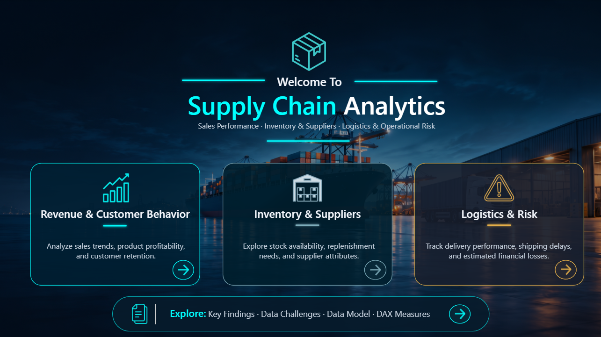
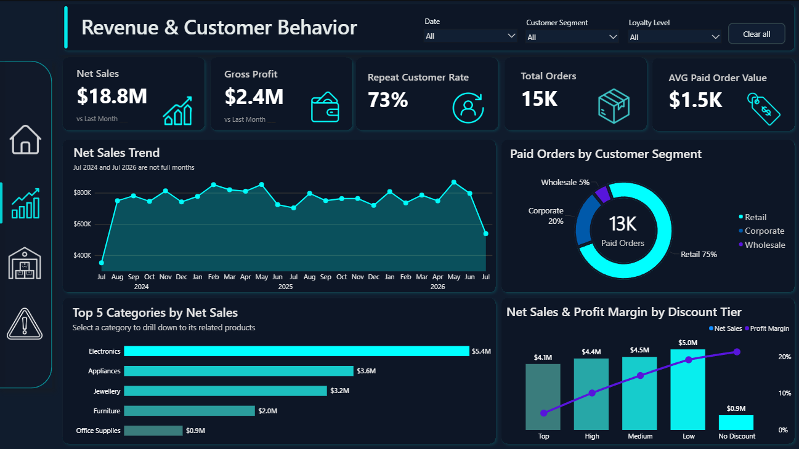
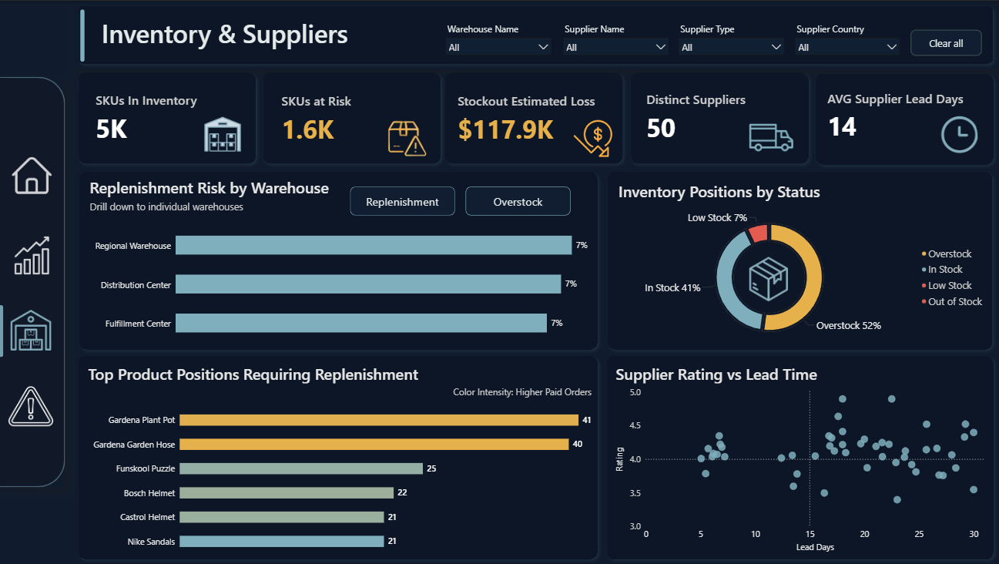
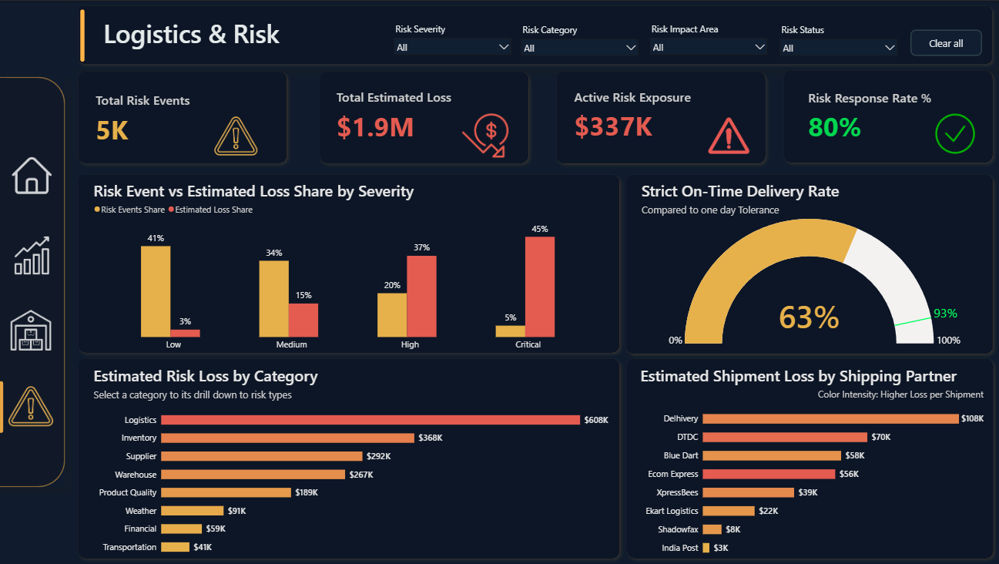
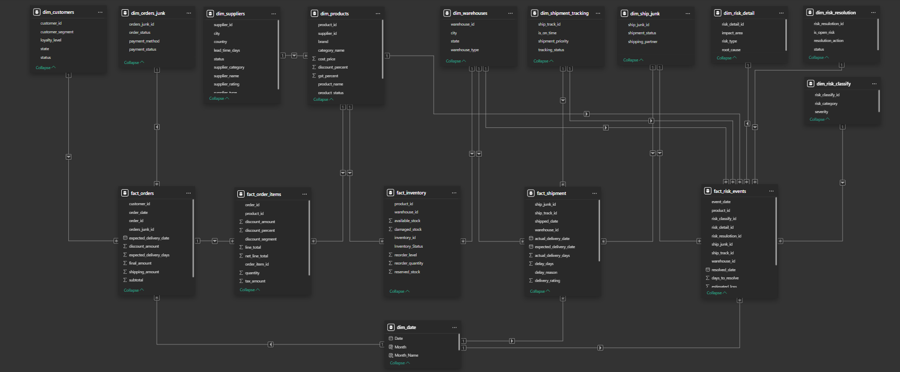

# Supply Chain Performance & Operational Risk Analysis

**An End-to-End Power BI Analytics Project**

## Project Overview

This project examines supply-chain performance across profitability, customer retention, inventory availability, delivery reliability, and operational risk, with a focus on identifying performance gaps and improvement opportunities.

To support reliable conclusions, I investigated source-data inconsistencies, reconstructed key revenue calculations, and tested alternative inventory and delivery definitions rather than accepting the supplied fields and rules at face value.

## At a Glance

- **Risk:** Just **25% of risk events** accounted for **82% of the estimated losses**.
- **Discounts:** High-Top tiers generated **45% of Net Sales but only 26% of Gross Profit**.
- **Customer Retention:** 5-point increase in Bronze repeat rate could bring additional **$108K in Net Sales**.
- **Data Quality:** Inconsistent source revenue fields made gross profit appear to be an **$8.9M loss**.

| Project Scope | Details                                                                             |
| ------------- | ----------------------------------------------------------------------------------- |
| Report Pages  | 4 (Home + 3 analytical pages)                                                       |
| Data Source   | End-to-End Supply Chain dataset (Kaggle)                                            |
| Data Model    | Galaxy schema with 5 fact tables and 11 dimension tables                            |
| Data Scale    | 15k orders, 45K order lines, 25k inventory positions, 15k shipments, 5k risk events |

**Power BI Report:** [Download the Report](Supply_Chain_Performance_and_Operational_Risk_Analysis.pbix)

## Dashboard Preview

View the Home Page

### 1. Revenue & Customer Behavior

Analyzes paid sales and gross profit over time, highlighting differences across customer segments, product categories, and discount tiers.

### 2. Inventory & Suppliers

Highlights replenishment needs and potential excess inventory across products and warehouses, alongside supplier ratings and lead days.  
Supplier selections filter related products and inventory positions.

### 3. Logistics & Risk

Highlights risk event distribution, estimated losses, unresolved cases, and delivery performance under strict & one day tolerance definitions. It also compares estimated shipment losses across shipping partners.

## Data Challenges & Analytical Decisions

### 1. Inconsistent Source Revenue Fields Made Paid Sales Appear to Generate an $8.9M Gross Loss

**Problem**

- Using `fact_orders[final_amount]` to calculate gross profit for paid orders produced about **-$8.9M**.
- The source's `fact_order_items[line_total]` also failed to align with the row-level data and produced a negative gross profit, with an even lower total sales.

**Analytical Decision**

I rebuilt the order line amounts using:

`(quantity * unit_price) - discount_amount + tax_amount`

- Sales measures use the recalculated amounts after excluding tax.
- The new calculations produced **$18.8M Net Sales** and **$2.4M Gross Profit**.

### 2. A Lenient Overstock Rule May Have Left Excess Stock Unnoticed

**Problem**

The source classified only **4,207 of 25,000 product-warehouse positions (16.8%)** as Overstock. By testing different safety-buffer thresholds against the reorder parameters, I found that an Available Stock threshold about **290%** produced a closely matching distribution. However, this does not confirm the source's exact rule.

**Analytical Decision**

I applied a **150% threshold** to the combined reorder parameters. This flagged **13,030 positions (52%)** - over three times the source count, bringing additional excess-stock positions to light.

**Business Impact**

Overstock is the largest Inventory risk type in the source with about **$136K in estimated losses**. The revised rule gives planners additional positions to review before placing replenishment orders or reallocating stock, potentially reducing future losses.

_Note: The 150% threshold is an analytical assumption, not a documented rule._

### 3. Conflicting Expected Dates and Delay Labels Changed the Delivery Rate

**Problem**

- I found that order and shipment tables contained different expected delivery dates for **13,349 of 15,000 shipments (89%)**.
- Among **9,078 completed shipments, excluding returns**, **3,544 (39%)** received different On-Time/Late classifications depending on which date was used.
- The source's `shipment_status` only classified shipments as `Delayed` when they were at least **2 days late**. As a result, **2,788 shipments arrived one day late** without being classified as Delayed, compared with only 600 shipments that were flagged.

**Analytical Decision**

- I used the shipment expected date for delivery analysis because actual delivery date are recorded only in the shipment table. _The source does not document which date represents the confirmed one._
- I introduced two separate delivery measures, both excluded Returned and Pending shipments:
  - **63% Strict On-Time:** Any delay counted as late.
  - **93% One-Day Tolerance:** Allowed being one day late (aligned with the shipment status criteria).
- _orders expected date resulted **58%** using the strict rule._

**Business Context**

- **Financial Risk:** Delivery delays were associated with **$140K in estimated losses**.
- **Monitoring Gap:** The source's `Delayed` status marked only **7% of eligible shipments**, while the strict analysis identified **37% as late**.
- **Business Value:** The revised delivery analysis provides clearer visibility into delayed shipments, supporting earlier follow-ups to help reduce future delay-related losses.

## Insights & Recommended Actions

### 1. A Quarter of Risk Events Accounted for 82% of Estimated Losses

**Key Findings**

- In 2025 **5K risk events** carried **$1.9M in estimated losses (20.6% of annual net sales)**.
- High and Critical events represented only **25%** of the events but accounted for **82%** of the losses.
- **249 High-Critical** cases remained Open or Investigating with **$269.4K** in estimated losses, while another **273** cases were Mitigated.

Risk Types with Supporting Analysis:

| Risk Type      |  Cases | Estimated Loss |
| -------------- | -----: | -------------: |
| Overstock      |     24 |     **$38.3K** |
| Stockout       |     20 |     **$29.6K** |
| Late Delivery  |      9 |     **$17.1K** |
| Shipment Delay |     15 |     **$15.9K** |
| **Total**      | **68** |    **$100.9K** |

**Recommended Actions**

- **Overstock:** Review the top product-warehouse positions flagged by the revised rule before placing new orders or reallocating stock.
- **Stockout:** Prioritize replenishment by reviewing warehouse-level stockout rates and most demanded products.
- **Delays:** Use the strict delivery rate to identify late shipments missed by the source's two-day delay rule to improve shipment visibility and enable earlier follow-up

These actions help prioritize and address current risks more effectively, while supporting better operational decisions to reduce the occurrence of similar events in the future.

Note

_Estimated losses represent potential financial losses, not confirmed actual losses._

### 2. High and Top Discount Tiers Accounted for 45% of Net Sales but Only 26% of Gross Profit

**Key Findings**

High-Top discount tiers generated $8.45M of Net Sales but only $629K of Gross Profit.

| Discount (Limit) | Units Sold | Gross Profit | Margin |
| ---------------- | ---------: | -----------: | -----: |
| (0%) No Discount |      6,366 |        $194K |  21.3% |
| (5%) Low         |     32,598 |        $949K |  19.2% |
| (10%) Medium     |     31,981 |        $667K |  14.8% |
| (15%) High       |     31,767 |        $443K |  10.1% |
| (20%) Top        |     32,049 |        $186K |   4.6% |

Units sold nearly flat across discount tiers, while gross profit dropped significantly at higher discounts.

**New Discount Scenarios**

| Discount Scenario | Profit Increase | Volume Drop to Break-even |
| ----------------- | --------------: | ------------------------: |
| High & Top at 5%  |         +$1.04M |                   **62%** |
| High & Top at 10% |          +$545K |                   **46%** |

**Recommended Actions**

- **Discount Optimization:** Test these discount limits on selected High-Top products. The scenarios reveal a potential Gross Profit increase as long as the units sold drop stays below the Break-even levels.
- **Inventory:** Check whether High-Top discount products align with products flagged by the new Overstock rule. This could help determine whether overstock was the reason for these discounts. If confirmed, the new Overstock rule could help identify excess stock earlier to reduce the need for such discounts in the future.

Note

_Volume Drop to Break-even shows the percentage drop in units sold that will bring gross profit back to its current level._

### 3. Bronze Customers Represent the Largest Repeat-Purchase Opportunity

**Key Finding**

Among **3,923 qualified customers**, 1,807 (46%) placed a second paid order within 180 days of their first recorded paid order.

| Loyalty Level | Eligible Customers | 180-Day Repeat Rate |
| ------------- | -----------------: | ------------------: |
| Bronze        |              1,442 |             **27%** |
| Silver        |              1,282 |                 47% |
| Gold          |                843 |                 61% |
| Platinum      |                356 |             **84%** |
| **Total**     |          **3,923** |             **46%** |

The criteria used to assign loyalty tiers was not documented.

**Opportunity**

- Bronze customers represented **37%** of the group but had the lowest repeat-purchase rate.
- Their average paid order value is **$1.5K**, similar to Platinum customers.
- A hypothetical only 5-point improvement (27% to 32%) could bring about **72 additional returning customers**, representing around **$108K in net sales** if each placed only one additional order.

**Recommended Action**

Test personalized product recommendations or rewards with Bronze customers who have not placed a second order. Compare the results against a control group, tracking repeat purchases and gross profit per customer.

Notes

- Qualified customers had their first recorded paid order on or before 21-Jan-2026, allowing a full 180-day period to 20 July 2026.
- This 180-day analysis is separate from the dashboard Repeat Customer Rate KPI.

## Data Model & Technical Highlights

### Data Model

The project uses a **multi-fact (Galaxy) schema** with five fact tables, each retaining its own grain and connected to related dimensions.

| Fact Table         | Grain                                  |
| ------------------ | -------------------------------------- |
| `fact_orders`      | One row per customer order             |
| `fact_order_items` | One row per order line                 |
| `fact_inventory`   | One row per product-warehouse position |
| `fact_shipment`    | One row per shipment                   |
| `fact_risk_events` | One row per risk event                 |

### Key Technical Highlights

- **Fact Table Design:** Maintained separate order-header and order-line tables to preserve their grains. Excluded `fact_shipping_risk` as it shares the same grain as `fact_risk_events`.
- **Relationships:** one-to-many relationships with single-direction filtering. The only direct fact-to-fact relationship connects `fact_orders` to `fact_order_items`, linking each order header to its order lines.
- **Supplier Filtering:** The `dim_suppliers` → `dim_products` → `fact_inventory` path allows supplier selections to filter related products and their inventory positions.
- **Shipment & Risk Integration:** Integrated shipment attributes into `fact_risk_events` using `shipment_id`, allowing shared dimensions to filter both tables. Validated row count, unique IDs, and loss totals.
- **Power Query & DAX:** Used Power Query for data cleaning, transformations, and feature engineering, applied DAX measures for KPIs, using `KEEPFILTERS` and `REMOVEFILTERS` to manage filter context.
- **Data Validation:** Verified fact-table grains, dimension-key uniqueness, and foreign-key matching. IQR flagged 824 estimated-loss outliers, all were associated with High-Critical events so retained after review.

Data Scope & Interpretation Notes

- **Data Coverage:** Sales records cover July 2024 to July 2026. Risk events only cover 2025. Inventory is a single snapshot, not a historical inventory series.
- **Financial Measures:** Net Sales use reconstructed order-line amounts for paid orders, excluding tax and customer shipping fees, matched 1:1 to shipping costs.
- **Currency Conversion:** Monetary values were converted using a fixed average exchange rate of **88.2 INR per USD**, based on monthly rates from Jul 2024 to Jul 2026. [[X-Rates](https://www.x-rates.com/average/)].
- **Inventory:** Some products appear with different units. Source does not specify whether `available_stock` excludes reserved and damaged stock.
- **Supplier Attributes:** The dataset has no purchase order or goods receipt records to analyze actual supplier performance.
- **Risk Data:** Risk statuses represent current values, with no historical status change.

## Documentation & Data Source

Detailed project documentation is available in the repository:

- **[Project Documentation:](02_Documentation/Project_Documentation.md)** Data preparation, ETL decisions, data modeling, validation, and analytical findings.
- **[DAX Measures:](02_Documentation/DAX_Measures.md)** Business definitions, DAX formulas, formats, filter behavior, and validation notes.
- **[Project Log:](02_Documentation/Project_Log.md)** Key investigations, analytical and modeling decisions, and validation results.

**Dataset:** [End-to-End Supply Chain dataset](https://www.kaggle.com/datasets/shivangirathore28/end-to-end-supply-chain-dataset) (Kaggle)

## About the Author

**Youssef Hazem Youssef**

Junior Data Analyst | Software Engineering Graduate

- **LinkedIn:** [View LinkedIn Profile](https://www.linkedin.com/in/youssef-hazem-youssef/)
- **Email:** youssef2598@gmail.com
